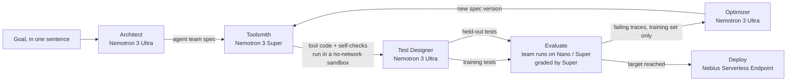

# NemoForge


**Describe a job in one sentence. Get back a team of AI agents that has been designed, tested, improved and deployed for you.**

NemoForge is an agent that builds agents. It runs entirely on **NVIDIA Nemotron** models served by **Nebius Token Factory**, and it ships what it builds to a **Nebius Serverless Endpoint**.

Built for the Nebius x NVIDIA Global AI Hackathon (Best Apps and Agents track).

## Why

Building a useful agent today takes days of prompt tweaking, tool writing and guesswork about whether it actually works. Most teams skip the testing and find out in production. NemoForge does all of that work automatically, and it does the part people usually skip: it measures the agent on tests it has never seen before it ships it.

## How it works



1. **Architect (Nemotron 3 Ultra)** turns the goal into a spec: the smallest team of agents that can do the job, a precise system prompt for each, which tools each may use, and which model tier each runs on. It is told to prefer the cheapest tier that works.
2. **Toolsmith (Nemotron 3 Super)** writes any custom Python tools the Architect asked for, plus self-checks, and keeps fixing the code until the checks pass. Generated code never runs in the NemoForge process: each call is a fresh `python -I` subprocess with no network (`unshare -rn`), no API keys in its environment, CPU, memory and file-size limits, and a timeout.
3. **Test Designer (Nemotron 3 Ultra)** writes realistic test cases with pass criteria: typical requests, messy edge cases, and requests the system should refuse. A third of them are **held out**.
4. **Evaluate.** The team runs every test on Nemotron (most agents on **Nano**), and **Super** grades each answer against its criteria.
5. **Optimizer (Nemotron 3 Ultra)** reads the full traces of the failing *training* tests, diagnoses the root cause and rewrites the design: prompts, tools, tiers or the agent line-up. It never sees the held-out tests, so the held-out score shows whether a fix generalises or just overfits.
6. Steps 4 and 5 repeat until both scores pass the target (default 90%) or the round limit is hit. The best version is kept.
7. **Deploy.** The finished spec is packaged with the runtime into a container and deployed as a **Nebius Serverless Endpoint** with token auth, serving `POST /invoke` and a small web page.

Every version of the spec is saved as JSON (`builds/<id>/spec_v1.json`, `spec_v2.json`, ...), so you can diff exactly what the optimizer changed.

## How Nemotron and Nebius are used

| Role | Model | Why this tier |
| --- | --- | --- |
| Architect, Test Designer, Optimizer | Nemotron 3 Ultra | Few calls, each needing deep reasoning about design and failure causes |
| Toolsmith, Grader | Nemotron 3 Super | Code writing and careful judgement at moderate cost |
| Built agents (default) | Nemotron 3 Nano | Most calls happen here, so speed and cost matter most |

- **Nebius Token Factory** serves all models through its OpenAI-compatible API. The dashboard shows calls and tokens per tier for every build.
- **Nebius Serverless Endpoints** host the finished agent teams (CPU preset, since the models are called through Token Factory).
- **Tavily** powers the built-in `web_search` and `fetch_url` tools that the Architect can give to research agents.

Model IDs are set in `nemoforge/config.py` and can be overridden with `NF_MODEL_NANO`, `NF_MODEL_SUPER` and `NF_MODEL_ULTRA`.

## Run it

```bash
python -m venv .venv && source .venv/bin/activate
pip install -r requirements.txt
export NEBIUS_API_KEY=...      # Nebius Token Factory
export TAVILY_API_KEY=...      # optional, enables web research tools
python -m nemoforge serve        # open http://127.0.0.1:8000
```

The first time the dashboard starts with an empty `builds/` folder, it copies in two recorded real Nemotron runs from `demo/builds/`, so you can explore the dashboard without spending any credit (no API key needed). Set `NF_DEMO_BUILDS=0` to skip this.

### Self-healing builds

When a build gets stuck, NemoForge repairs it on its own:

- **Stuck below target.** If every improvement round is used up and the team still misses the target, the **Healer** (Nemotron Ultra) reviews all the rounds at once: the scores, every change the Optimizer made, and the tests that failed in every round. It looks for what the round-by-round Optimizer kept missing (a structural problem, overfitting, a change that made things worse, a broken tool), then redesigns the team from the best version so far. A bonus round runs the repaired team on the same tests and the dashboard shows the result, for example "training 50% → 100%".
- **Crash.** If a stage crashes, the Healer reads the error and the last steps, explains it in plain words, and rebuilds with notes that avoid the crash. Errors that a redesign cannot fix (a missing API key, no network, budget used up) are not retried.

Held-out tests stay hidden: the Healer only sees their scores, never their inputs. The open build shows a **Self-healing** panel with the diagnosis, root causes, repairs and before/after scores, the chart marks the healed round, and the Builds list says **self-healed**. Set `NF_HEAL_ROUNDS` (default 1) and `NF_HEAL_RETRIES` (default 1) to change how many repairs a build may try, or `0` to turn healing off. Every repair is paid from the same build budget.

### Nemotron routing

NemoForge picks the smallest Nemotron model that can do each job: Ultra designs the agent team and judges hard tests, Super does the main work, and Nano handles fast, everyday calls such as grading. The **Nemotron routing** panel on the home page shows how many calls and tokens went to each tier, and what the same tokens would have cost if every call had gone to Ultra. The numbers come from real token counts in your builds and the list prices in `nemoforge/config.py`.

A build that stopped before it finished (for example because the server was restarted) is now shown as **Interrupted** instead of **Failed**. Interrupted and failed builds get a **Rebuild** button that puts the same goal back in the build box so you can start it again.

### Dashboard cards and observability logs

The **agent registry** panel, above the cards, shows the owner (set `NF_OWNER`, default Praveen), a spotlight on the latest agent with its team, scores and cost, and a table of every agent built. Click one to open it; **Close build** hides the open build again.

Below the agent team, ten cards summarise every build stored in `builds/`: volume (builds, model calls, tokens), quality (pass rate, average held-out score, tests graded), cost and speed (total spend, average build time) and risk (overfitting caught, high and critical alerts). Every number is computed from the recorded events, not estimated.

The **Observability logs** button lists every input NemoForge handled as its own record: each build goal, each test case the shipped version was graded on, and each "Try the finished agent" run. Each record gets a severity (critical, high, medium, low, info) from fixed rules, and clicking it shows which rules fired. For example, a failed held-out test is high and a crashed build is critical. The same data is at `/api/logs` and `/api/stats`.

### Long meetings (Microsoft Teams transcripts)

The "Try the finished agent" box accepts up to 200,000 characters, enough for a full 1-hour meeting. **Load transcript** reads a Teams `.vtt` (or `.txt`) export and turns it into `Name: text` lines, dropping timestamps. Try the last example goal, "Summarise a long meeting transcript...", to build a meeting summariser.

Or from the command line:

```bash
python -m nemoforge build "Turn messy meeting notes into a summary, decisions and action items with owners"
python -m nemoforge run <build-id> "notes: ..." --trace
```

### Keep costs down

Every model call is priced per tier (approximate list prices, override with `NF_PRICE_<TIER>_IN` / `_OUT` in USD per 1M tokens), and the dashboard shows the running cost of each build. A build stops at its budget (default $0.50, `NF_BUDGET_USD` or `--budget`) and keeps the best version so far. Lite mode (`--lite` or the dashboard checkbox) sends Ultra's jobs to Super, which is roughly 3x cheaper.

```bash
python -m nemoforge build "..." --lite --cases 4 --rounds 2 --budget 0.10   # a cheap first run
```

### Deploy a build to Nebius

Prerequisites: the [Nebius CLI](https://docs.nebius.com/cli) configured for your project, Docker, a Nebius container registry and a subnet ID.

```bash
export NF_ENDPOINT_TOKEN=$(openssl rand -hex 32)
python -m nemoforge deploy <build-id> --registry cr.eu-north1.nebius.cloud/<registry-id> --subnet-id <subnet-id>        # prints the commands
python -m nemoforge deploy <build-id> --registry cr.eu-north1.nebius.cloud/<registry-id> --subnet-id <subnet-id> --yes  # runs them
```

Then call it:

```bash
curl -X POST "$ENDPOINT_URL/invoke" -H "Authorization: Bearer $NF_ENDPOINT_TOKEN" \
  -H "Content-Type: application/json" -d '{"input": "..."}'
```

### Host NemoForge itself

The root `Dockerfile` packages the dashboard. Deploy it the same way (container port 8000). Set `NF_ACCESS_CODE` so visitors need a code before starting builds that spend your Token Factory credits. Live deploys from the web app stay off unless `NF_ALLOW_DEPLOY=1`.

## Tests

```bash
pytest
```

The unit tests use a scripted stand-in model to check the plumbing (JSON parsing, sandbox isolation, the runtime's tool loop, the build loop, the web API, access codes and restoring builds after a restart) without network access. Real builds always use Nemotron.

## Project layout

```
nemoforge/
  architect.py   Ultra: goal -> agent team spec
  toolsmith.py   Super: writes and self-tests custom tools
  evals.py       Ultra writes tests; Super grades answers
  optimizer.py   Ultra: diagnoses failures and rewrites the spec
  forge.py       the build loop, with training / held-out split
  runtime.py     runs a spec: agents in sequence with a JSON tool-call loop
  tools.py       built-in tools and the sandbox for generated code
  llm.py         Nemotron tier router on Token Factory, token accounting
  server.py      web app API with live event streaming
  insights.py    observability log records, severities and dashboard KPIs
  serve.py       the server that gets deployed for one finished build
  deploy.py      container packaging and Nebius endpoint deployment
web/index.html   the dashboard
```

## License

Apache License 2.0. See [LICENSE](LICENSE).
