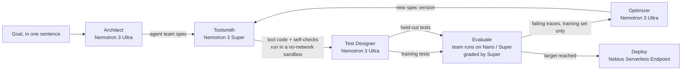

# Agent Foundry


**Describe a job in one sentence. Get back a team of AI agents that has been designed, tested, improved and deployed for you.**

Agent Foundry is an agent that builds agents. It runs entirely on **NVIDIA Nemotron** models served by **Nebius Token Factory**, and it ships what it builds to a **Nebius Serverless Endpoint**.

Built for the Nebius x NVIDIA Global AI Hackathon (Best Apps and Agents track).

## Why

Building a useful agent today takes days of prompt tweaking, tool writing and guesswork about whether it actually works. Most teams skip the testing and find out in production. Agent Foundry does all of that work automatically, and it does the part people usually skip: it measures the agent on tests it has never seen before it ships it.

## How it works



1. **Architect (Nemotron 3 Ultra)** turns the goal into a spec: the smallest team of agents that can do the job, a precise system prompt for each, which tools each may use, and which model tier each runs on. It is told to prefer the cheapest tier that works.
2. **Toolsmith (Nemotron 3 Super)** writes any custom Python tools the Architect asked for, plus self-checks, and keeps fixing the code until the checks pass. Generated code never runs in the Foundry process: each call is a fresh `python -I` subprocess with no network (`unshare -rn`), no API keys in its environment, CPU, memory and file-size limits, and a timeout.
3. **Test Designer (Nemotron 3 Ultra)** writes realistic test cases with pass criteria: typical requests, messy edge cases, and requests the system should refuse. A third of them are **held out**.
4. **Evaluate.** The team runs every test on Nemotron (most agents on **Nano**), and **Super** grades each answer against its criteria.
5. **Optimizer (Nemotron 3 Ultra)** reads the full traces of the failing *training* tests, diagnoses the root cause and rewrites the design: prompts, tools, tiers or the agent line-up. It never sees the held-out tests, so the held-out score shows whether a fix generalises or just overfits.
6. Steps 4 and 5 repeat until both scores pass the target (default 90%) or the round limit is hit. The best version is kept.
7. **Deploy.** The finished spec is packaged with the runtime into a container and deployed as a **Nebius Serverless Endpoint** with token auth, serving `POST /invoke` and a small web page.

Every version of the spec is saved as JSON (`builds/<id>/spec_v1.json`, `spec_v2.json`, ...), so you can diff exactly what the optimizer changed.

## How Nemotron and Nebius are used

| Role | Model | Why this tier |
| --- | --- | --- |
| Architect, Test Designer, Optimizer | Nemotron 3 Ultra | Few calls, each needing deep reasoning about design and failure causes |
| Toolsmith, Grader | Nemotron 3 Super | Code writing and careful judgement at moderate cost |
| Built agents (default) | Nemotron 3 Nano | Most calls happen here, so speed and cost matter most |

- **Nebius Token Factory** serves all models through its OpenAI-compatible API. The dashboard shows calls and tokens per tier for every build.
- **Nebius Serverless Endpoints** host the finished agent teams (CPU preset, since the models are called through Token Factory).
- **Tavily** powers the built-in `web_search` and `fetch_url` tools that the Architect can give to research agents.

Model IDs are set in `foundry/config.py` and can be overridden with `AF_MODEL_NANO`, `AF_MODEL_SUPER` and `AF_MODEL_ULTRA`.

## Run it

```bash
python -m venv .venv && source .venv/bin/activate
pip install -r requirements.txt
export NEBIUS_API_KEY=...      # Nebius Token Factory
export TAVILY_API_KEY=...      # optional, enables web research tools
python -m foundry serve        # open http://127.0.0.1:8000
```

Or from the command line:

```bash
python -m foundry build "Turn messy meeting notes into a summary, decisions and action items with owners"
python -m foundry run <build-id> "notes: ..." --trace
```

### Deploy a build to Nebius

Prerequisites: the [Nebius CLI](https://docs.nebius.com/cli) configured for your project, Docker, a Nebius container registry and a subnet ID.

```bash
export AF_ENDPOINT_TOKEN=$(openssl rand -hex 32)
python -m foundry deploy <build-id> --registry cr.eu-north1.nebius.cloud/<registry-id> --subnet-id <subnet-id>        # prints the commands
python -m foundry deploy <build-id> --registry cr.eu-north1.nebius.cloud/<registry-id> --subnet-id <subnet-id> --yes  # runs them
```

Then call it:

```bash
curl -X POST "$ENDPOINT_URL/invoke" -H "Authorization: Bearer $AF_ENDPOINT_TOKEN" \
  -H "Content-Type: application/json" -d '{"input": "..."}'
```

### Host the Foundry itself

The root `Dockerfile` packages the dashboard. Deploy it the same way (container port 8000). Set `AF_ACCESS_CODE` so visitors need a code before starting builds that spend your Token Factory credits. Live deploys from the web app stay off unless `AF_ALLOW_DEPLOY=1`.

## Tests

```bash
pytest
```

The unit tests use a scripted stand-in model to check the plumbing (JSON parsing, sandbox isolation, the runtime's tool loop, the build loop, the web API, access codes and restoring builds after a restart) without network access. Real builds always use Nemotron.

## Project layout

```
foundry/
  architect.py   Ultra: goal -> agent team spec
  toolsmith.py   Super: writes and self-tests custom tools
  evals.py       Ultra writes tests; Super grades answers
  optimizer.py   Ultra: diagnoses failures and rewrites the spec
  foundry.py     the build loop, with training / held-out split
  runtime.py     runs a spec: agents in sequence with a JSON tool-call loop
  tools.py       built-in tools and the sandbox for generated code
  llm.py         Nemotron tier router on Token Factory, token accounting
  server.py      web app API with live event streaming
  serve.py       the server that gets deployed for one finished build
  deploy.py      container packaging and Nebius endpoint deployment
web/index.html   the dashboard
```

## License

Apache License 2.0. See [LICENSE](LICENSE).
